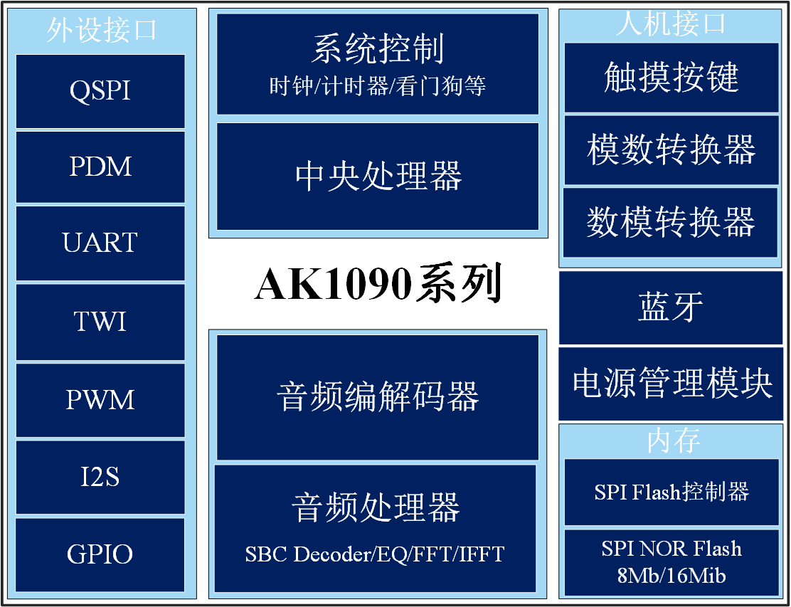

# AK1090 Series Chip Overview

The AK1090 series is an integrated audio SoC for TWS Bluetooth earbuds, OWS Bluetooth earphones, Bluetooth speakers and AI smart glasses. It integrates a Bluetooth radio, an audio processor, an audio codec and a power management unit, and supports low-power operation, balancing audio processing performance with power efficiency. The chip has two built-in touch-key interfaces that can be configured flexibly for user interaction, such as button controls. The AK1090 series also provides a range of peripheral interfaces, including I2S, PDM, UART, TWI and SPI, for audio data transfer, sensor connections and peripheral control, making system design more flexible and compatible.

## Block diagram

Diagram labels are in Chinese. Legend: **peripheral interfaces**: QSPI, PDM, UART, TWI, PWM, I2S, GPIO. **Core**: system control (clock, timers, watchdog); CPU; audio codec; audio processor (SBC decoder, EQ, FFT/IFFT). **Human interface**: touch keys, ADC, DAC. **Bluetooth.** **Power management unit.** **Memory**: SPI flash controller; 8 Mbit/16 Mbit SPI NOR flash.

## Specifications

**CPU**
- 32-bit RISC-V core

**Memory (flash)**
- 8 Mbit (1 MiB) or 16 Mbit (2 MiB) SPI NOR flash

**Bluetooth**
- Bluetooth v6.1
- BR/EDR and BLE modes

**Operating modes**
- Normal mode
- Standby mode
- Sleep mode
- Power-off mode

**Audio**
- 1 × Sigma-Delta DAC
- 2 × Sigma-Delta ADC
- SBC hardware decoding
- EQ (equaliser)
- FFT and IFFT accelerator

**Peripheral interfaces**
- SPI, PWM, UART, TWI, I2S, PDM, touch keys

**Package**
- QFN32/QFN30
