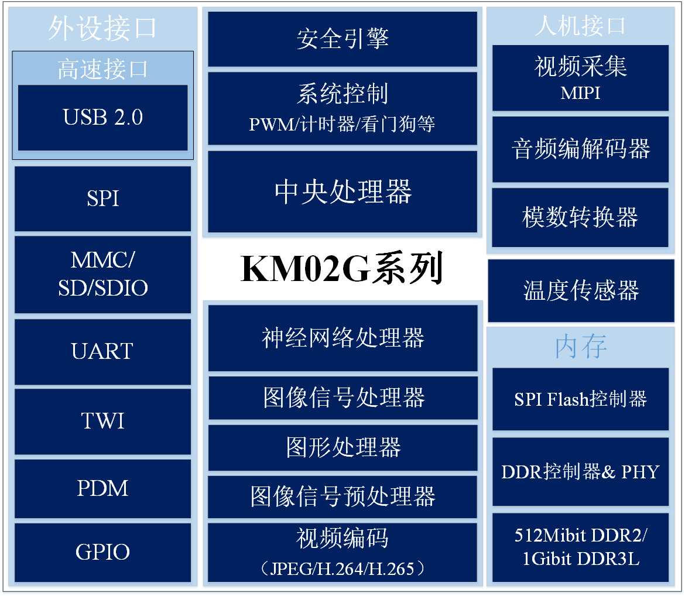

# KM02G Series Chip Overview

The KM02G series is an integrated image-processing SoC designed for AI camera glasses. It integrates an image signal processor (ISP) and an image processing unit (IPU), so image and video capture and basic processing can be done on the device. Its built-in stabilisation combines algorithms with hardware to reduce blur caused by hand shake or motion, keeping images steady when shooting on the move. The chip also integrates a neural processing unit (NPU) for recognition tasks such as gesture and speech recognition, meeting the typical human–machine interaction needs of AI smart glasses. The KM02G series comes in a compact package and has low power consumption, which suits wearables where size and battery life matter. It balances performance with power efficiency and makes system integration and product miniaturisation easier.

## Block diagram

Diagram labels are in Chinese. Legend: **peripheral interfaces**: USB 2.0 (high-speed), SPI, MMC/SD/SDIO, UART, TWI, PDM, GPIO. **Core**: security engine; system control (PWM, timers, watchdog); CPU; NPU; ISP; graphics processor; image signal preprocessor; video encoder (JPEG/H.264/H.265). **Human interface**: video capture (MIPI), audio codec, ADC. **Temperature sensor.** **Memory**: SPI flash controller; DDR controller and PHY; 512 Mbit DDR2 / 1 Gbit DDR3L.

## Specifications

**CPU**
- 64-bit dual-core RISC-V

**Memory**
 
  The KM02G series has two variants, KM02G1 and KM02G2, with different memory sizes.
- KM02G1: 512 Mbit (64 MiB) DDR2 SDRAM
- KM02G2: 1 Gbit (128 MiB) DDR3L SDRAM

**Camera**
- MIPI interface
- Two CIS inputs

**Image preprocessor**
- Image scaling and flipping
- Drawing and filling rectangles, triangles and diamonds
- Privacy masking
- Image OSD

**Image signal processor**
- Long/short-frame wide dynamic range (WDR)
- Auto white balance, auto exposure and autofocus
- Gamma correction
- Defective pixel correction
- 3D/2D noise reduction
- Edge enhancement

**2D graphics processor**
- Image scaling
- Bitmap distortion correction
- Bitmap blending
- Bitmap rotation at any angle
- Bitmap mesh warping

**Video encoder**
- H.265/H.264 encoder, up to 3840x2160
- JPEG encoder, up to 16384x8192

**Audio codec**
- 1 × 24-bit Sigma-Delta DAC
- 2 × 16-bit Sigma-Delta ADC

**Neural processing unit**
- Gesture recognition and speech recognition

**Peripheral interfaces**
- USB, SPI, MMC/SD/SDIO, UART, TWI, PDM

**Security engine**
- Secure boot
- AES/DES/3DES encryption and decryption
- SM3/MD5/SHA algorithms
- Random number generator

**Package**
- BGA114
