# 使用说明

```{note}
配套的 Anyka_Glasses APP 尚未随本次版本发布：没有提供安装包和源码。开发者可在后续版本中补充；本页目前仅供参考。
```

## 1 产品概述

Anyka\_Glasses APP是一款集成人工智能对话、实时视频传输、图像识别与媒体管理功能的移动应用程序。通过蓝牙连接移动终端，为用户提供便捷、智能的交互体验。本手册将详细介绍产品的各项功能及操作方法，帮助您快速掌握设备使用技巧。

## 2 绑定设备

首次使用时需要先绑定设备。

### 2.1 首次绑定流程

初次使用Anyka\_Glasses APP时，需完成设备与手机APP的绑定配对：

1\. 启动应用：打开手机中的Anyka\_Glasses APP

2\. 进入绑定界面：点击首页右上角"＋"图标或中央的"请绑定设备"按钮

3\. 扫描设备：系统将自动搜索周边的可用蓝牙设备

4\. 选择配对：在设备列表中找到您的智能眼镜型号并点击

5\. 确认连接：在弹出的蓝牙配对请求对话框中选择"绑定设备"

6\. 等待完成：界面显示连接成功提示，绑定过程结束

**注意事项：**

1\. 确保手机蓝牙、WiFi功能已开启

2\. 设备与手机距离应在10米范围内

3\. 如搜索不到设备，请检查设备是否处于可发现模式

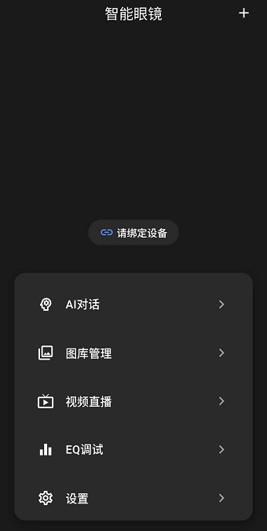

图2-1 未绑定设备时的界面</br><br>

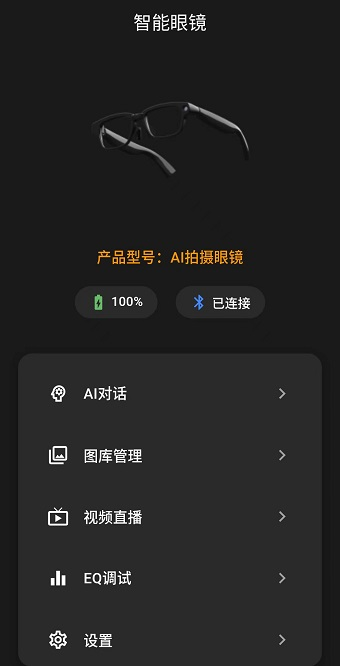

图2-2 已绑定设备的界面

### 2.2连接状态管理

绑定成功后，设备将自动保存连接信息。后续使用时，只需开启设备和APP，系统将自动尝试重连。主页面的连接状态指示器会实时显示当前连接状况。

## 3 AI对话

AI对话使用前需要获取license权限。有两种获取方式：

1、到[阿里云百炼平台](https://bailian.console.aliyun.com/)注册自己的账号，创建自己的AI对话大模型，分别记录APIKey、workspaceId、AppId，并在App的AI对话设置中填入，即可开启AI对话。

2、申请Anyka的license权限。进入AI对话时如果没有license权限，会提示license异常信息，复制该信息进行申请，申请成功后，重启App即可使用AI对话。

AI对话功能支持图像识别和语音问答两种模式。使用图像识别时，需先开启AI对话功能，然后在设备端双击拍照按钮进行抓拍，系统会自动通过APP将图片上传至大模型进行识别处理，识别结果将以语音播报形式反馈，同时在"AI对话"界面同步显示。需要注意的是，AI对话模式具有8秒超时限制，超过设定时间后将自动退出对话状态。

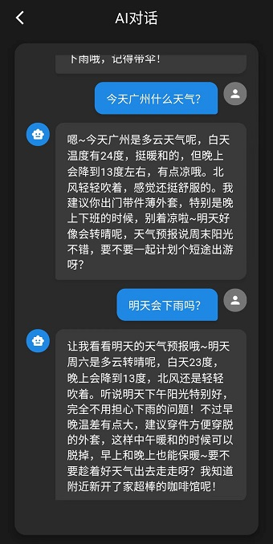

图3-1 AI对话的界面

### 3.1 功能启动方式

AI对话功能支持两种启动模式：

设备端启动：

1\. 定位眼镜架上的K2功能键

2\. 双击该按键

3\. 听到启动提示音后即可开始对话

**手机端启动：**

1\. 进入APP主界面

2\. 点击"AI对话"功能入口

### 3.2 AI识图操作指南

AI识图是产品的核心功能之一，操作流程如下：

1\. 激活对话：通过上述任一方式启动AI对话

2\. 准备拍摄：将眼镜对准待识别物体或场景

3\. 执行抓拍：双击眼镜上的拍照按钮

4\. 上传分析：系统自动上传图片至AI服务器

5\. 获取结果：接收语音播报的识别结果，同时在对话界面显示文字信息

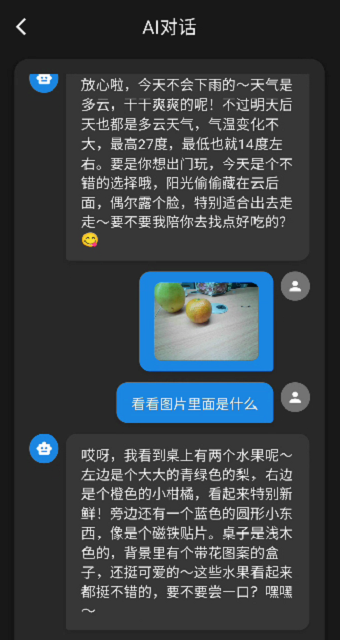

图3-2 AI识图

### 3.3 语音问答功能

在AI对话模式下，用户可以直接通过语音提出问题，系统将智能分析并给出语音回答。

## 4 图库管理

打开“图库管理”，可以查看设备端的照片和视频。

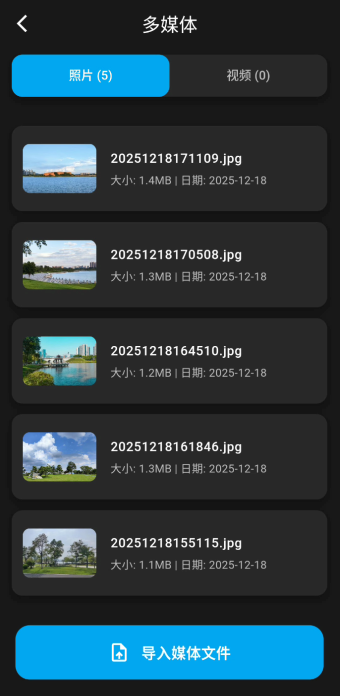

图4-1 图库管理的界面

### 4.1 图库浏览

通过"图库管理"功能，用户可以：

1)  按时间顺序浏览设备拍摄的照片和视频

2)  查看文件的详细信息（拍摄时间、文件大小等）

### 4.2 文件导入操作

将设备中的媒体文件导入手机的步骤：

1)  进入"图库管理"界面

2)  点击底部"导入媒体文件"按钮

3)  等待传输进度完成

4)  提示“X个文件导入成功”

### 4.3 文件管理功能

批量选择：

1)  长按照片或视频进入多选模式

2)  点击选择要操作的文件项目

3)  选择后可以进行删除操作

## 5 视频直播

打开“视频直播”，稍等片刻即可查看设备的实时视频画面。支持横屏全屏播放，点击视频区域可切换全屏模式。

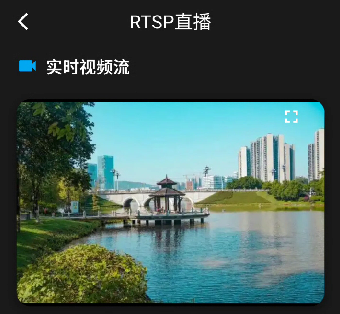

图5-1 视频直播的界面

## 6 设置功能
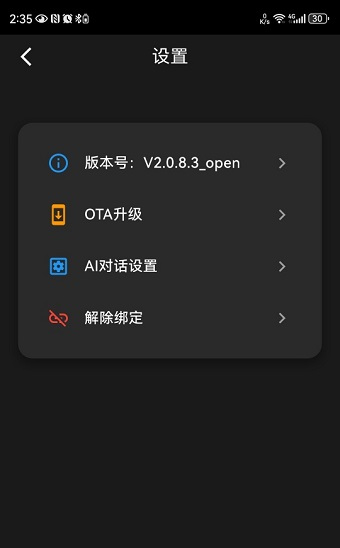

图6-1 设置的界面

### 6.1 版本信息

查看当前APP版本号，3秒内连续点击版本号5次即可显示隐藏设置功能。这些隐藏设置主要用于设备调试、开发测试以及高级用户自定义配置，普通用户通常无需访问这些选项：

1)  对话相关设置

手机AI对话开关: 控制手机AI对话功能的开启与关闭

上行音频播放: 实时播放设备上传的音频流

下行音频播放: 实时播放下发至设备的音频流

半双工交互模式: 切换对话交互模式

对话超时时间: 自定义对话超时时间（3-60秒可调）

2)  蓝牙与连接设置

蓝牙扫描规则: 自定义蓝牙设备扫描过滤条件

BLE数据下行: 选择数据传输方式

BLE连接类型: 选择蓝牙连接模式

3)  音频与设备调试

设备音频回环: 开启或关闭音频回环测试功能

保存上行PCM数据: 控制是否保存设备上传的原始PCM音频数据

图像处理设置

防抖放大系数: 调节视频防抖功能的放大倍数（范围1-2）

4)  调试与日志

P2P连接日志显示: 控制P2P连接详细日志的显示状态

5)  RTSP直播设置

直播超时时间: 设置RTSP直播超时时间（1-30分钟可调）

6)  录像设置

录像定时时长: 设置自动录像时长（1-600秒可调；设备端接受任意正数时长，小于或等于0时按600秒录像）

7)  UVC模式设置

UVC模式选择: 通过下拉菜单选择所需UVC模式

8)  OTA测试

OTA压力测试开关: 控制OTA升级压力测试功能的开启与关闭

### 6.2 OTA升级

固件升级功能专为设备固件更新而设计，目前支持AK1090系列芯片固件的OTA升级，AK1090系列芯片固件分为中文版本和英文版本，用户可根据需要烧录不同版本；这两个版本的固件尚未随本次版本发布（见“7 资料获取”），开发者可在后续版本中补充。
步骤如下：<br>
1) 把升级包放到手机存储中<br>
2) 进入APP的 "设置"→"OTA升级"→"蓝牙固件OTA升级" 界面
3) 点击箭头按钮，选取手机目录中的升级包文件，等待升级操作完成

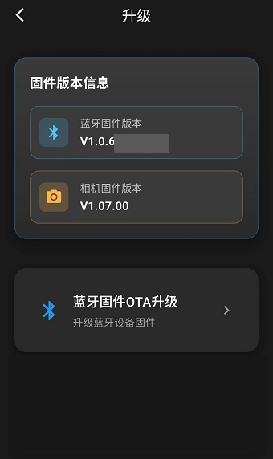

图6-2 OTA升级查看设备版本信息的界面

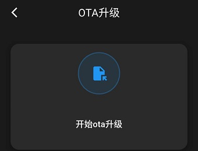

图6-3 OTA未选择升级文件时的界面

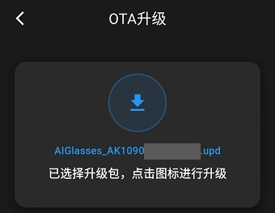

图6-4 OTA已选择升级文件的界面

### 6.3 AI对话设置

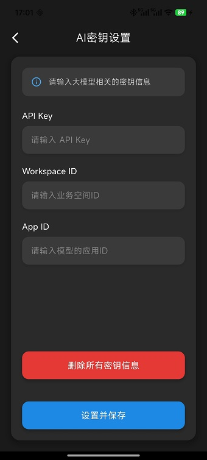

图6-5 AI密钥设置的界面

设置AI对话密钥，如果用户有自己的阿里百炼AI大模型，可以填入API Key、Workspace Id、App Id等密钥。设置成功后即可使用AI对话。如果没有或者不想创建自己的AI大模型，可以向Anyka FAE申请license权限来使用AI对话。

### 6.4 解除绑定

解除与当前设备的绑定关系，位于帮助下方，是该卡片区域的最后一个功能项。出于安全考虑，点击后会弹出确认对话框，用户需要确认才能执行解绑操作。

## 7 资料获取

Anyka_Glasses APP 安装包（APK）及 AK1090 系列芯片固件（中文版、英文版）尚未随本次版本发布。开发者可在后续版本中上传这些软件包，并在本节补充下载链接。
