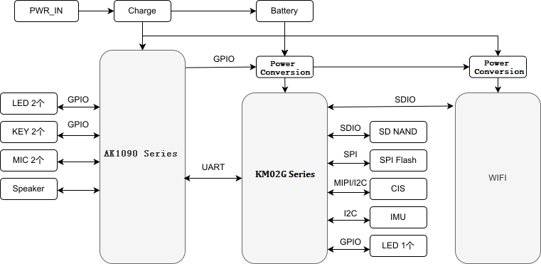
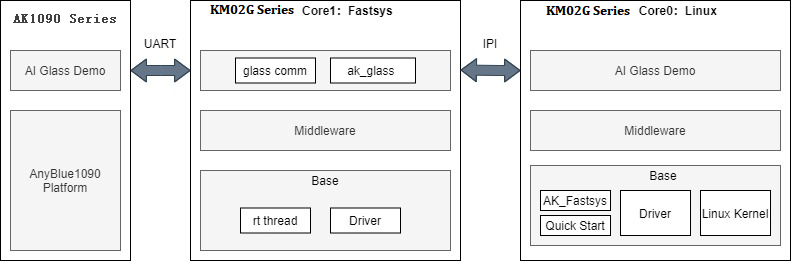
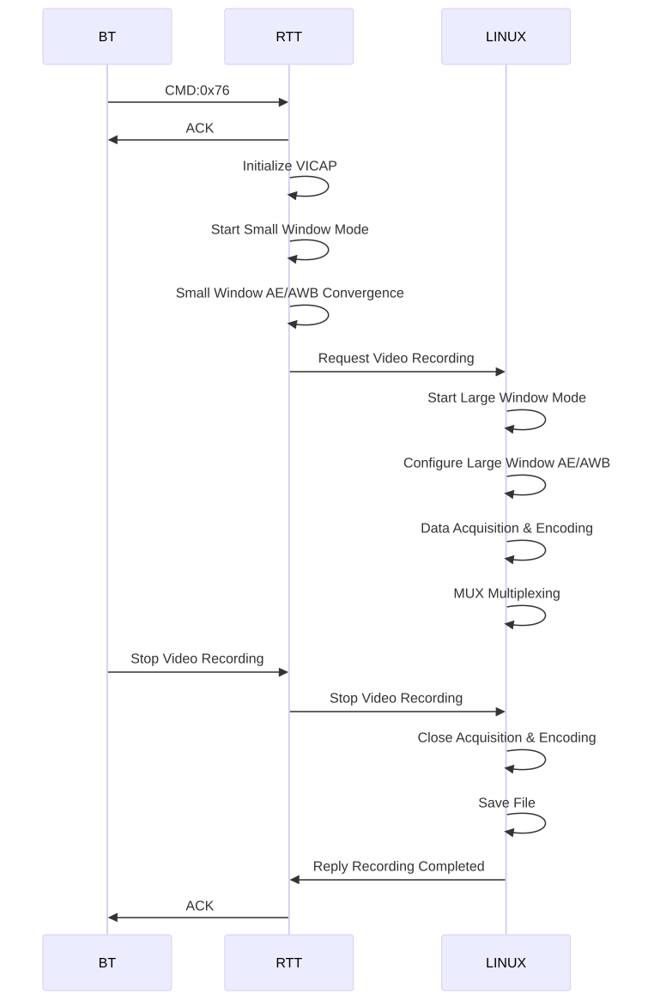
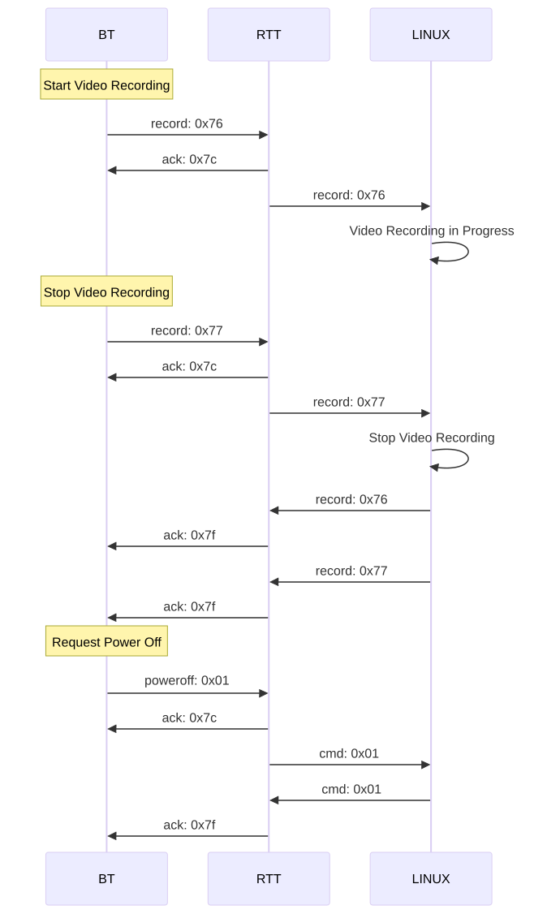
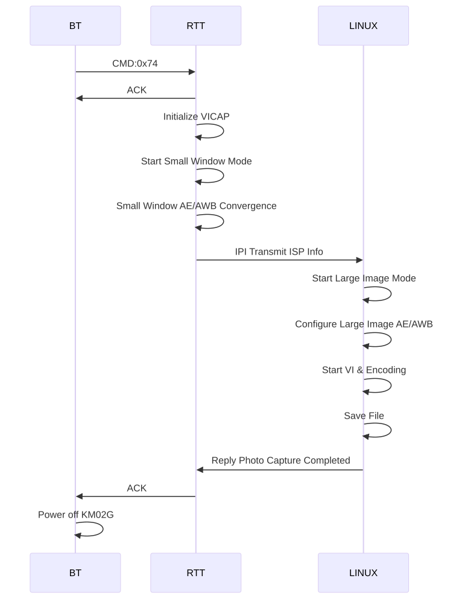
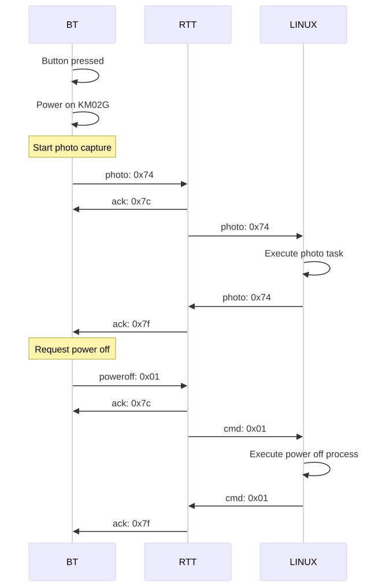
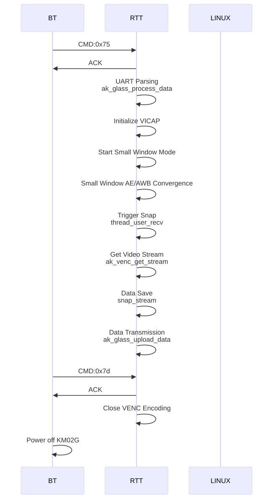
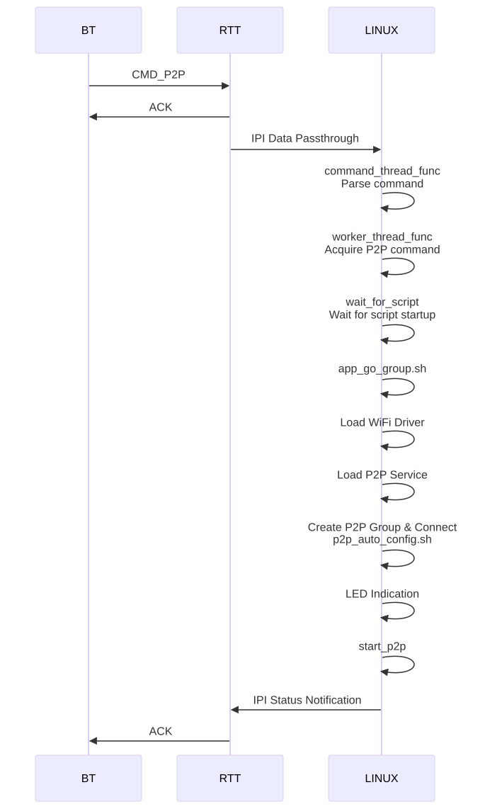

# 应用开发说明

## 第一章 概述

本文档介绍AI眼镜SDK的应用开发，目的是供您在开发过程中开发眼镜应用程序。

### 1.1 产品版本

与本文档相对应的产品版本如下。

| 芯片简介      | 操作系统      |
| --------- | --------- |
| KM02G系列芯片 | Linux+RTT |

### 1.2 硬件版本

| 硬件名称 | 芯片                   | 说明 |
| ---- | -------------------- | -- |
| 产品板  | KM02G系列芯片+AK1090系列芯片 |    |

### 1.3 缩写说明

本文会用到如下缩写词：

- **APP**：眼镜手机端 Anyka_Glasses 程序
- **BT**：蓝牙模块（AK1090系列芯片）
- **RTT**：运行在 KM02G系列芯片 上的 RT-Thread 系统
- **LINUX**：运行在 KM02G系列芯片 上的 Linux 系统

---

## 第二章 方案整体设计

### 2.1 系统框图



1. KM02G系列芯片的上电或者断电，均由AK1090系列芯片进行控制。
2. AK1090系列芯片跟KM02G系列芯片之间通过UART进行通信，波特率为1500000。
3. WIFI 模块挂载到 KM02G系列芯片 上。
4. IMU、SD NAND、CIS(SENSOR) 均挂载到 KM02G系列芯片 上。
5. 喇叭、按键均挂载到AK1090系列芯片上。

### 2.2 软件架构设计

KM02G系列芯片内核运行系统如下图所示：



AI眼镜的完整软件解决方案采用异构多核架构，包含三套相互协作的系统：

**AK1090系列芯片 蓝牙芯片**

- 运行AK1090系列芯片固件，负责蓝牙通信功能
- 主要实现与手机 App 及 KM02G系列芯片 的通信
- 承担音频播放等基础功能

**KM02G系列芯片 双核处理器**

- **Core1 - Fastsys 实时小系统**
  - 运行轻量级实时操作系统
  - 负责与AK1090系列芯片的 UART 串口通信
  - 执行 AE（自动曝光）快速收敛等实时性要求高的任务
- **Core0 - Linux 应用系统**
  - 运行完整的 Linux 操作系统
  - 承载 AI 眼镜的主应用程序
  - 处理复杂的算法和业务逻辑

**系统间通信机制**

- 蓝牙与 KM02G系列芯片：通过 UART 串口进行数据交换
- KM02G系列芯片 双核间通信：采用 IPI（Inter-Processor Interrupt）核间通信机制实现两个核心系统的信息交互

这种分层架构设计实现了功能解耦和性能优化，确保了系统的实时性和计算能力的平衡。

**注意事项：** SDK 包含录像、拍照、抓拍、P2P 几种模式，只允许一种模式存在。上电默认不发模式则为 U 盘模式，其他命令可根据不同的模式进行多条控制及搭配使用。

---

### 2.3 录像流程

录像工作流程如下图所示：



1. AK1090系列芯片发起录像命令（按键），先开机 KM02G系列芯片，发送串口 CMD，KM02G系列芯片 的 RTT 端接收到消息，反馈消息收到，开启一系列操作，且把录像命令透传 Linux，Linux 端进行命令解析，开启录像线程。
2. 收到录像停止命令，CMD 流程同上，收到后，进行录像文件的保存，IPI 发送完成命令。
3. 具体实现可参考应用代码 `apps/ai_glass_demo/libVideoRecordCode` 目录。
4. 完整命令交互流程如下图：（录像指令部分）\
   

---

### 2.4 拍照流程

拍照工作流程如下图所示：



命令交互如下图所示：



---

### 2.5 抓拍流程

抓拍流程如下图所示：



**注意：** 抓拍流程在 RTT 端进行实现，Linux 端不进行参与。

---

### 2.6 P2P流程

P2P流程如下图所示：



P2P 流程用于如下三个功能：

1. P2P 配网
2. P2P 导图
3. P2P 直播

具体实现方式可参考 `ai_glass_demo` 应用程序当中，`ai_glass_cmd_handle.c` 文件里的 `handle_wifi_p2p_mode` 函数内容。

---

## 第三章 LINUX应用程序介绍

### 3.1 目录与文件结构介绍

代码位置：ai_glass_demo

```
├── common
│   ├── config
│   │   ├── app_main_config.ini
│   │   ├── camera_gc13b0.ini
│   │   └── eis_gc13b0.ini
│   ├── inc
│   │   ├── ai_glass_cmd_handle.h
│   │   ├── ai_glass_cmd_ipi.h
│   │   ├── ai_glass_cmd_queue.h
│   │   ├── ai_glass_common.h
│   │   ├── ai_glass_isp_quick.h
│   │   ├── ai_glass_log.h
│   │   ├── ai_glass_time.h
│   │   ├── ak_list.h
│   │   ├── ftp_monitor.h
│   │   ├── fun_log.h
│   │   ├── fw_media_types.h
│   │   ├── ini_parser.h
│   │   ├── media_configs.h
│   │   ├── ring_buffer.h
│   │   ├── sdnand_manager.h
│   │   └── wifi_manager.h
│   └── src
│       ├── ai_glass_cmd_handle.c
│       ├── ai_glass_cmd_ipi.c
│       ├── ai_glass_cmd_queue.c
│       ├── ai_glass_common.c
│       ├── ai_glass_isp_quick.c
│       ├── ai_glass_log.c
│       ├── ai_glass_time.c
│       ├── ftp_monitor.c
│       ├── fun_log.c
│       ├── ini_parser.c
│       ├── media_configs.c
│       ├── ring_buffer.c
│       ├── sdnand_manager.c
│       └── wifi_manager.c
├── common.mk
├── libAudioRecordCode
│   ├── ak_sound_demo.c
│   └── ak_sound_demo.h
├── libLiveStreamCode
│   ├── ak_circular_buffer.h
│   ├── ak_rtsp_demo.c
│   ├── ak_rtsp_demo.h
│   ├── ak_rtsp_server_demo.c
│   └── ak_rtsp_server.h
├── libTakePhotoCode
│   ├── ak_dma_api.c
│   ├── ak_dma_api.h
│   ├── ak_snap_demo.c
│   ├── ak_snap_demo.h
│   ├── usb_webcam.c
│   ├── usb_webcam.h
│   ├── video.c
│   └── video.h
├── libVideoEis
│   ├── ak_sc7i22_cmd.h
│   ├── antiShake.c
│   ├── antiShake.h
│   ├── print_color_simple.h
│   ├── video_eis.c
│   └── video_eis.h
├── libVideoRecordCode
│   ├── ak_gyro_app.c
│   ├── ak_gyro_app.h
│   ├── ak_mux_sample.c
│   ├── ak_mux_sample.h
│   ├── ak_record_demo.c
│   └── ak_record_demo.h
├── main.c
└── Makefile
```

---

### 3.2 源码文件说明

1：main.c 程序主入口与消息处理中心。

2：lib开头的为相关的模块功能

- libAudioRecordCode ：音频录制
- libLiveStreamCode：直播服务
- libTakePhotoCode：拍照
- libVideoEis：电子防抖
- libVideoRecordCode：视频录制

3：common 下的为各个功能相关文件，config为通用配置，可读写，对应板端 /etc/config/\
inc为对应h文件，src为c文件。

- ai_glass_cmd_handle.c     主要处理linux端的命令响应。
- ai_glass_cmd_ipi.c            主要为ipi核间程序。
- ai_glass_cmd_queue.c      消息队列相关
- ai_glass_common.c            公共函数相关
- ai_glass_isp_quick.c ipi    视频相关
- ai_glass_log.c log            日志相关
- ai_glass_time.c                 时间函数相关
- ftp_monitor.c                   ftp检测相关
- fun_log.c                          log日志相关
- ini_parser.c                       ini解析
- media_configs.c               媒体配置，包含读写ini
- sdnand_manager.c sd nand 管理相关
- wifi_manager.c                wifi相关函数

---

### 3.3 IPI核间通信应用模块接口说明

apps/ai_glass_demo/common/inc/ai_glass_cmd_ipi.h 文件是负责RTT与LINUX核间通信的应用代码接口文件，关键接口说明如下。

1. int ai_glass_ipi_cmd_get\
   获取RTT发给LINUX的消息，以便LINUX应用执行后续的抓图，录像和直播等任务。
2. void ai_glass_ipi_cmd_completed\
   从ai_glass_ipi_cmd_get接口获取的消息，在处理完成之后必须通过此接口报告处理完成，否则，无法成功再次获取消息。
3. set_glass_info_v4\
   此接口用于回复RTT发给LINUX的消息
4. set_glass_info_v4_notify\
   此接口用于主动给RTT发送通知

---

### 3.4 配置文件说明

配置文件存放在应用程序源码目录apps/ai_glass_demo/common/config下，程序运行时安装在设备端的/etc/config/目录下

**1：应用主配置文件 app_main_config.ini**

源码目录apps/ai_glass_demo/common/config下的app_main_config.ini是应用主配置文件，编译时build_apps.sh会将其复制到rootfs/config/。此文件设备运行时路径为/etc/config/app_main_config.ini。如需查看各模块的输出日志，可修改此ini文件。非控制台打印的日志保存在Linux的/mnt/Log目录。

```ini
[Common]
dmesg=0                   ; 0:disable 1:enable     内核日志
middle_log=0              ; 0:默认级别 1:warn 2:warn 3:notice 4及以上:error   中间件日志级别
rtt_log=0                 ; 0:disable 1:enable     RTT系统日志
app_log=0                 ; 0:error 1:warn 2:info 3:debug   Linux应用demo日志
app_log_save=0            ; 0:console 1:save file  中间件和Linux应用demo日志输出方式。0表示输出到控制台，1表示保存到文件
power_off_time=0          ; poweroff_time for debug，单位为秒。

[DebugAp]
; 调试 Wi-Fi 热点。password 为 WPA2 密码（8–63 字符），为空时图像调试模式和 USB 拍照模式不开启热点
; 值后面不能加注释：= 之后的全部内容都属于值
ssid=AI_GLASS_DEBUG
password=
```

请不要直接修改受 git 跟踪的 `app_main_config.ini`：把它复制到 `rootfs/config.local/` 后再修改，编译时该目录中的文件会在配置镜像中替换 `rootfs/config/` 中的同名文件（见[编译环境配置](build-environment.md)）。

调试热点请为每台设备或每次调试使用唯一的 SSID 和强 WPA2 密码，不要复用生产环境或公司 Wi-Fi 凭据。调试结束后将 `image_debug_mode` 恢复为 `0`，并清除 `rootfs/config.local/` 中的调试热点配置。

**注：** 通过以上配置文件，RTT 日志和 Linux 内核日志输出的位置是 `/mnt/Log` 目录。用户也可使用命令直接输出到控制台。Linux 内核日志通过输入 `dmesg` 命令查看，RTT 日志可通过输入 `cat /dev/fastsys-log` 命令查看。

---

**2: Camera配置文件**

应用程序源码目录apps/ai_glass_demo/common/config/中，形如camera_xxx.ini的ini文件是不同cis类型的camera配置文件。SDK编译脚本build_apps.sh会将camera_gc13b0.ini复制为camera.ini。设备运行时这个配置文件的路径是/etc/config/camera.ini。

文件内容如下：   

---

### [Camera]

```ini
; 拍照isp参数
snap_isp_config=/fast/isp_gc13b0_mipi_2lane_av200.conf
; 录像isp参数（路径类的值后面不能加注释）
video_isp_config=/fast/isp_gc13b0_mipi_2lane_av200_30fps.conf
```

---

### [Record]

```ini
main_chn_width=2080         ; 远程防抖（默认）分辨率为 2080*1536
main_chn_height=1536        ; 开启本地防抖时需要裁剪，改为 1600*1200
main_vi_width=2080
main_vi_height=1536
main_chn_fps=30
main_chn_target_kbps=20480  ; 20*1024
main_chn_max_kbps=20480
main_chn_gop_len=90
main_chn_enc_type=0         ; 0:h264 1:mjpeg 2:h265
main_chn_br_mode=5          ; 0:cbr 1:vbr 2:capped_vbr 5:avbr
eis_enable=0                ; 0表示远程防抖（默认）：设备端不防抖，由手机APP防抖，本次发布不含该APP，因此默认录像不防抖; 1表示本地防抖，修改这个值必须对应地修改本段的main_chn_width与main_chn_height的值
image_debug_mode=0          ; 0表示关闭图像调试; 1表示开启图像调试：若 app_main_config.ini 的 [DebugAp] password 已设置 WPA2 密码（8–63 字符），设备以AP模式开启WIFI并启动rtsp服务，可通过手机或者电脑的rtsp客户端播放设备的视频流，以便调试图像效果；未设置时不开启AP，也不启动rtsp服务。
```

---

### [Rtsp]

```ini
main_chn_width=2080         ; 因需要裁剪，开启本地防抖分辨率配置成 1600*1200
main_chn_height=1536        ; 关闭防抖分辨率配置成 2080*1536
main_vi_width=2080
main_vi_height=1536
main_chn_fps=30
main_chn_target_kbps=2048   ; 2*1024
main_chn_max_kbps=3072      ; 3*1024
main_chn_gop_len=60         ; 2*30
main_chn_enc_type=0         ; 0:h264 1:mjpeg 2:h265
main_chn_br_mode=5          ; 0:cbr 1:vbr 2:capped_vbr 5:avbr
eis_enable = 0              ; 0表示关闭防抖; 1表示开启本地防抖，修改这个值必须对应地修改本段的main_chn_width与main_chn_height值
```

---

### [Photo]

```ini
main_chn_fps=10
main_org_width=3840         ; 输入宽
main_org_height=2880        ; 输入高
main_res_width=4032         ; 输出宽
main_res_height=3024        ; 输出高
main_jpg_slice_num=3        ; 分片编码次数
main_org_slice_one_height=960   ; 2880/3 每次切割像素
main_jpg_slice_one_height=1008  ; 3024/3 每次编码像素
```

---

**3: 陀螺仪的零偏校准配置**

设备固件烧录后，初次使用时，需要对陀螺仪进行零偏校准，以保证后续正常使用防抖功能。操作步骤如下：

1. 将眼镜放置水平状态，开启录像，应用程序会自动将陀螺仪的零偏校准值保存至 `/etc/config/eis_offset.cfg` 文件中。至此零偏校正过程完成。
2. 如果在做零偏校准时眼镜不处于水平状态，只需要删除 `/etc/config/eis_offset.cfg` 文件后再次完成步骤1重做一次零偏校准即可。

---

## 第四章 常用调试方法

### 4.1 RTSP点播

视频流地址：rtsp://xx.xx.xx.xx/vs0

```{warning}
此 `rtsp://` 调试流仅限通过临时、隔离的 DebugAp 使用。不要把该热点桥接、路由或端口转发到办公网络、生产网络或互联网；调试结束后关闭 `image_debug_mode` 并清除调试热点配置。
```

---

### 4.2 LED调试

```bash
# 常亮
echo 1 > /sys/devices/platform/leds/leds/state_led/brightness

# 关闭
echo 0 > /sys/devices/platform/leds/leds/state_led/brightness

# 闪烁（亮100ms，灭200ms）
echo "on 100 200" > /sys/devices/platform/leds/leds/state_led/flash
```

### 4.3 普通GPIO设置

```bash
# 导出GPIO
echo xx > /sys/class/gpio/export

# 设置为输出模式
echo out > /sys/class/gpio/gpioxx/direction

# 拉低电平
echo 0 > /sys/class/gpio/gpioxx/value

# 拉高电平
echo 1 > /sys/class/gpio/gpioxx/value
```

---

### 4.4 **查看分区**

```bash
cat /proc/mtd
```

---

### 4.5 设备端本地防抖还是手机端APP远程防抖

修改 `/etc/config/camera.ini` 文件中 `[Record]` 段的 `eis_enable` 字段，可决定是采用设备端本地防抖还是手机 APP 端远程防抖。\
默认采用 APP 端远程防抖（`eis_enable=0`，`main_chn_width` 和 `main_chn_height` 与 `main_vi_width`、`main_vi_height` 一致，为 2080×1536）。此时设备端保存未经防抖的原始录像（文件名带 `_origin`），由 Anyka_Glasses APP 完成防抖；该 APP 尚未随本次版本发布，可由开发者在后续版本中补充，因此目前使用默认配置时录像不做防抖。如改用设备端本地防抖，需将 `eis_enable` 改为 1，并把 `main_chn_width` 和 `main_chn_height` 改为 1600×1200。

---

### 4.6 开启H264/H265录像

修改 `/etc/config/camera.ini` 中 `[Record]` 下的 `main_chn_enc_type`。目前 MJPEG 录像不可用。

---

### 4.7 如何快速命令查看收发

RTT 端主要负责命令转发，只有少数特殊命令需要处理，如抓拍等。\
日志打印通常带有前缀关键字，表示收发方向。

- `[ipi->linux]`: 表示 RTT 通过 IPI 发给 Linux 的命令
- `[linux->ipi]`: 表示 Linux 通过 IPI 发给 RTT 的命令
- `[rtt->bt]`: 表示 RTT 发给蓝牙的命令
