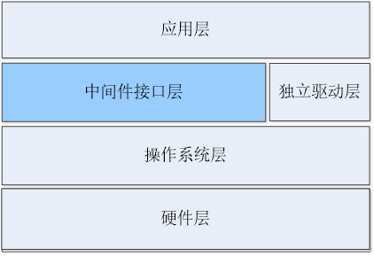

# 架构
## 系统架构

&emsp;&emsp;系统层次如图 1-1所示：

| **主要系统层次** | **描述**                                                     |
| ---------------- | ------------------------------------------------------------ |
| 应用层           | 基于平台及其他驱动，由用户开发的应用软件系统。               |
| 中间件接口层     | 控制芯片完成相应的媒体处理功能，为用户提供上层应用编程接口。 |
| 独立驱动层       | 相应的驱动模块。                                             |
| 操作系统层       | 支持RTOS系统或者linux系统。                                  |
| 硬件层           | 由芯片加上必要的外围器件构成。外围器件包括Flash、以太网、WiFi、LCD等。 |

 

## 中间件简介

&emsp;&emsp;中间件接口层，支持应用软件快速开发。中间件接口层对应用软件屏蔽了芯片相关的复杂底层处理，为用户直接提供上层应用编程接口以实现相应功能。主要功能包括：公共服务、内存管理、多线程操作、日志打印、音视频处理、视频叠加显示、图像二维引擎、解析和合成等。

| **功能模块** | **功能描述**                                      |
| ------------ | ------------------------------------------------- |
| Common       | 提供跨平台的基本功能函数，比如日期时间等          |
| Memory       | 提供内存池、循环buffer、DMA操作的通用管理模块     |
| Thread       | 提供跨平台的线程操作函数                          |
| Log          | 提供日志访问功能                                  |
| Audio        | 提供音频设备输入输出、音效处理、编解码codec等操作 |
| Video        | 提供视频输入输出、图像处理、编解码codec等操作     |

 
