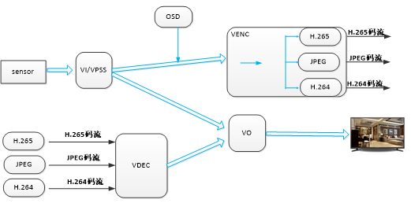

# 视频

&emsp;&emsp;视频处理相关模块主要包括视频输入（VI）、视频处理子系统（VPSS）、视频编码（VENC）、视频解码（VDEC）、视频输出(VO)等模块。

```{admonition} TODO
:class: warning

本文档未包含视频解码（VDEC）和视频输出（VO）模块的接口说明，待安凯确认 KM02G 系列芯片是否支持这两个模块。

This documentation has no API pages for video decoding (VDEC) or video output (VO). Anyka to confirm whether the KM02G series supports them.
```

&emsp;&emsp;主要的处理流程介绍如图 6-1所示：



<br/>

​        视频类的sample，包括vi、vpss的sample运行之前需要先加载采集相关的驱动，包括ak_vi.ko、sensor_xxx.ko、ak_vicap.ko、ak_isp.ko、ak_pp.ko，一般是运行脚本，以GC5603的CIS为例，可以参考脚本gc5603.sh，具体命令如下：

​        insmod /usr/modules/ak_vi.ko

​        insmod /usr/modules/sensor_gc5603.ko

​        insmod /usr/modules/ak_vicap.ko

​        insmod /usr/modules/ak_isp.ko

​        insmod /usr/modules/ak_pp.ko

​        其他CIS请参考对应的加载脚本xxx.sh。

​        venc和video的sample还需要加载编码的驱动：ak_venc_adapter.ko和ak_venc_bridge.ko。命令如下：

​        insmod /usr/modules/ak_venc_adapter.ko

​        insmod /usr/modules/ak_venc_bridge.ko

​        视频类的sample运行时，参数都要指定相应CIS的ispconf文件完整路径，否则无法运行。
