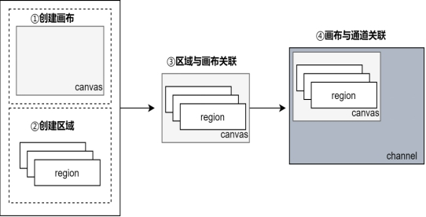
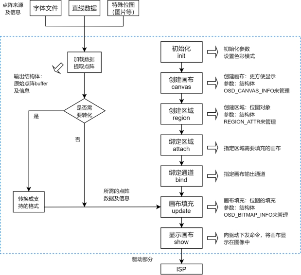

# 视频叠加显示

## 概述

&emsp;&emsp;视频叠加显示模块（OSD模块）。

<br/>

OSD画布、区域、通道的基本概念：

- **画布（canvas）：**

- 在图像上的指定位置划分出一块区域，可以使用户自由的画出需要的字符，需要考虑内存的分配和使用。

- **区域（region）：**

- 画布内所有的位图使用region区域进行管理，region是一个虚拟的概念，是对画布内各位图数据的划分。

- **通道（channel）：**

  - 指vpss channel的通道，OSD支持主通道和次通道。

绑定关系如下图所示：



OSD模块主要工作流程如图 所示：



## API  参考

&emsp;&emsp;本模块提供以下API参考，如下表所示。

| 数据结构               | 描述               |
| ---------------------- | ------------------ |
| OSD_COLOR_MODE_E       | 图像模式枚举       |
| OSD_COLOR_TYPE_E       | 色彩类型枚举       |
| OSD_ATTR_S             | osd属性结构体      |
| OSD_VECTOR_S           | osd位置结构体      |
| OSD_CANVAS_INFO_S      | 画布属性结构体     |
| OSD_REGION_ATTR_S      | OSD区域属性        |
| OSD_REGION_DATA_S      | OSD区域数据        |
| OSD_REG_TYPE_E         | OSD区域枚举类型    |
| OSD_BITMAP_ATTR_S      | 位图属性结构体     |
| OSD_BITMAP_INFO_S      | 位图信息结构体     |
| OSD_FONT_ATTR_S        | 字体属性结构体     |
| LINE_POSITION_ATTR_S   | 直线数据结构体     |
| OSD_BIND_TYPE_E        | 绑定类型枚举       |
| OSD_BIND_CANVAS_INFO_S | 画布绑定信息       |
| OSD_BIND_REGION_INFO_S | 区域绑定信息       |
| OSD_BIND_INFO_S        | 查询绑定信息结构体 |

<br/>

|  **函数接口 **           |  **描述 **                                      |
| ---------------------------- | --------------------------------------------------- |
| AK_MPI_OSD_Init          | OSD初始化接口            |
| AK_MPI_OSD_CreateCanvas  | 创建画布                 |
| AK_MPI_OSD_CreateRegion  | 创建区域                 |
| AK_MPI_OSD_AttachRegion  | 绑定区域与画布           |
| AK_MPI_OSD_DetachRegion  | 解绑区域与画布           |
| AK_MPI_OSD_BindVi        | 绑定画布与通道           |
| AK_MPI_OSD_UnbindVi      | 解绑画布与通道           |
| AK_MPI_OSD_UpdateRegion  | 更新区域数据             |
| AK_MPI_OSD_ShowCanvas    | 显示画布内容             |
| AK_MPI_OSD_SetRegionAttr | 设置区域属性             |
| AK_MPI_OSD_GetRegionAttr | 获取区域属性             |
| AK_MPI_OSD_DestroyRegion | 销毁区域                 |
| AK_MPI_OSD_CleanCanvas   | 清空画布内容             |
| AK_MPI_OSD_DestroyCanvas | 销毁画布                 |
| AK_MPI_OSD_Destroy       | 退出OSD                  |
| AK_MPI_OSD_GetCanvasAttr | 获取画布属性             |
| AK_MPI_OSD_SetCanvasAttr | 设置画布属性             |
| AK_MPI_OSD_GetStrBmp     | 将字符串转换成位图       |
| AK_MPI_OSD_ReleaseBmpBuf | 释放位图buffer           |
| AK_MPI_OSD_GetBindInfo   | 获取画布与区域的绑定信息 |
<br/>

## 数据结构

### **OSD_COLOR_MODE_E**

  【说明】

  图像模式枚举。

  【定义】

```c
typedef enum akOSD_COLOR_MODE_E
{
    AK_OSD_COLOR_FMT_YUV = 0,
    AK_OSD_COLOR_FMT_RGB,
    AK_OSD_COLOR_FMT_SUPPORT_NUM
}OSD_COLOR_MODE_E;
```

  【成员】

| **成员名称**                 | **描述**   |
| ---------------------------- | ---------- |
| AK_OSD_COLOR_FMT_YUV         | YUV格式    |
| AK_OSD_COLOR_FMT_RGB         | RGB格式    |
| AK_OSD_COLOR_FMT_SUPPORT_NUM | 支持的数量 |

  【相关函数接口】

```c
   AK_S32 AK_MPI_OSD_Init(OSD_ATTR_S *pstOsdAttrValue);
```

### **OSD_COLOR_TYPE_E**

  【说明】

  色彩类型枚举。

  【定义】

```c
typedef enum akOSD_COLOR_TYPE_E
{
    AK_OSD_TYPE_COLOR = 0,
    AK_OSD_TYPE_MONO,
    AK_OSD_TYPE_SUPPORT_NUM
}OSD_COLOR_TYPE_E;
```

  【成员】

| **成员名称**            | **描述**                                        |
| ----------------------- | ----------------------------------------------- |
| AK_OSD_TYPE_COLOR       | 彩色模式                                        |
| AK_OSD_TYPE_MONO        | 黑白模式（仅AK3918AV100、AK3918EV300L芯片支持） |
| AK_OSD_TYPE_SUPPORT_NUM | 支持的数量                                      |

  【相关函数接口】

```c
   AK_S32 AK_MPI_OSD_Init(OSD_ATTR_S *pstOsdAttrValue);
```

### **OSD_ATTR_S**

  【说明】

  osd属性结构体。

  【定义】

```c
typedef struct akOSD_ATTR_S
{
    OSD_COLOR_MODE_E enColorModeIndex;
    AK_U32 *pu32ColorTable;
    OSD_COLOR_TYPE_E enColorType;
}OSD_ATTR_S;
```

  【成员】

| **成员名称**     | **描述**                                                     |
| ---------------- | ------------------------------------------------------------ |
| enColorModeIndex | enColorModeIndex是u32ColorTable的颜色格式，支持YUV和RGB888   |
| pu32ColorTable   | u32ColorTable是颜色表数组，维度为16，每项是一种颜色。Return_LineFeedu32ColorTable的颜色，V330最高的8bit没有使用，AV100最高的8bit是alpha值，0完全透明，255完全不透明。Return_LineFeed若color_table参数传null，则使用默认颜色表。 |
| enColorType      | 颜色类型，彩色或者黑白色，默认是彩色。                       |

  【相关函数接口】

```c
   AK_S32 AK_MPI_OSD_Init(OSD_ATTR_S *pstOsdAttrValue);
```

### OSD_VECTOR_S

  【说明】

  osd位置结构体。

  【定义】

```c
typedef struct akOSD_VECTOR_S
{
    AK_U32 u32X;
    AK_U32 u32Y;
}OSD_VECTOR_S;
```

  【成员】

| **成员名称** | **描述**                |
| ------------ | ----------------------- |
| u32X         | 水平方向坐标，2像素对齐 |
| u32Y         | 垂直方向坐标            |

  【相关函数接口】

```c
AK_S32 AK_MPI_OSD_CreateCanvas(AK_S32 s32CanvasId, OSD_CANVAS_INFO_S *pstOsdCanvasInfo);
```

### **OSD_CANVAS_INFO_S**

  【说明】

  画布属性结构体

  【定义】

```c
typedef struct akOSD_CANVAS_INFO_S
{
    OSD_VECTOR_S stPosInYuv;      //position in yuv
    AK_S32 s32CanvasSizeHeight;   //height of canvas
    AK_S32 s32CanvasSizeWidth;    //width of canvas
    AK_S32 s32CanvasColorIndex;   //background color of canvas
    AK_S32 s32Alpha;              //unsupport
    AK_S32 s32BitWidth;           //bitwidth
}OSD_CANVAS_INFO_S;
```

  【成员】

| **成员名称**        | **描述**                                                     |
| ------------------- | ------------------------------------------------------------ |
| stPosInYuv          | 见vector结构体                                               |
| s32CanvasColorIndex | 画布的背景颜色，由bit_width决定最大的颜色id。                |
| s32Alpha            | 画布的透明度，暂不支持此参数                                 |
| s32CanvasSizeHeight | 画布高度，单位像素                                           |
| s32CanvasSizeWidth  | 画布宽度，单位像素                                           |
| s32BitWidth         | 位宽，支持1，2，4，默认是4。彩色时，根据bit_width的不同，可使用颜色表的前2/4/16种颜色。黑白色时，不使用color_table。根据bit_width来确定颜色数据的意义。1bit：在1bit宽度下，0x0表示黑色，0x1表示白色。可以用来实现带底色黑白文字。2bit：在2bit宽度下，[0]位的定义相当于1bit模式下的定义；[1]位0表示完全透明，1表示不透明。可以用来实现描边黑白文字。4bit：在4bit宽度下，[0]位的定义相当于1bit模式下的定义；[3:1]位为8级alpha通道，0表示完全透明，7表示完全不透明。可以用来实现抗锯齿黑白文字。 |

  【相关函数接口】

```c
AK_S32 AK_MPI_OSD_CreateCanvas(AK_S32 s32CanvasId, OSD_CANVAS_INFO_S *pstOsdCanvasInfo);
```

### **OSD_REGION_ATTR_S**

  【说明】

  OSD区域属性

  【定义】

```c
typedef struct akOSD_REGION_ATTR_S{
    AK_S32 s32Priority;                         //priority of cover region
    AK_S32 s32Width;                            //width of region
    AK_S32 s32Height;                           //hegiht of region
}OSD_REGION_ATTR_S;
```

  【成员】

| **成员名称** | **描述**                                                     |
| ------------ | ------------------------------------------------------------ |
| s32Priority  | 重叠区域优先级，只对重叠区域有效。如region0, region1,region2的优先级是1，2，3，则表示先显示region0，后显示region1, 再显示region2。重叠区域仅支持一个region绑定一个画布。 |
| s32Width     | 区域的宽                                                     |
| s32Height    | 区域的高                                                     |

  【相关函数接口】

```c
AK_S32 AK_MPI_OSD_CreateRegion(AK_S32 s32RegionId,OSD_REGION_ATTR_S *pstRegionAttr);
```

### **OSD_REGION_DATA_S**

  【说明】

  OSD区域数据

  【定义】

```c
typedef struct akOSD_REGION_DATA_S{
    OSD_REG_TYPE_E enType;                   //OSD region type
    AK_S32 s32ForceWriteFlag;                //force write font data when the bitmap size bigger than canvas size.
    union{
        OSD_BITMAP_INFO_S stOsdBitmapInfo;          //bitmap data
        OSD_FONT_ATTR_S stFontAttr;                 //string data
        LINE_POSITION_ATTR_S stLinePositionAttr;    //line data
    }data;
}OSD_REGION_DATA_S;
```

  【成员】

| **成员名称**       | **描述**                                                     |
| ------------------ | ------------------------------------------------------------ |
| enType             | OSD区域枚举类型                                              |
| s32ForceWriteFlag  | 强制写入标记【1：强制写入，0：非强制写入】，只对字符数据有效。当写入的字符数据超过画布范围时，最后一个字符数据若强制写入，则可能会出现乱码，若不强制写入，则不写入最后一个字符，保留可显示的完整字符。 |
| stOsdBitmapInfo    | 位图数据                                                     |
| stFontAttr         | 字体数据                                                     |
| stLinePositionAttr | 直线数据                                                     |

  【相关函数接口】

```c
AK_S32 AK_MPI_OSD_UpdateRegion(AK_S32 s32RegionId, AK_S32 s32Status, OSD_REGION_DATA_S *pstRegionData);
```

### **OSD_REG_TYPE_E**

  【说明】

  OSD区域枚举类型

  【定义】

```c
typedef enum akOSD_REG_TYPE_E {
    OSD_REG_INV = 0,     //undefine
    OSD_REG_LINE = 1,    //line
    OSD_REG_FONT = 2,    //font
    OSD_REG_BITMAP = 3,  //bitmap
}OSD_REG_TYPE_E;
```

  【成员】

| **成员名称**   | **描述**       |
| -------------- | -------------- |
| OSD_REG_INV    | 未定义的，保留 |
| OSD_REG_LINE   | 直线类型       |
| OSD_REG_FONT   | 字符类型       |
| OSD_REG_BITMAP | 点阵图片类型   |

  【相关函数接口】

```c
AK_S32 AK_MPI_OSD_UpdateRegion(AK_S32 s32RegionId, AK_S32 s32Status, OSD_REGION_DATA_S *pstRegionData);
```

### **OSD_BITMAP_ATTR_S**

  【说明】

  位图属性结构体。

  【定义】

```c
typedef struct akOSD_BITMAP_ATTR_S
{
    AK_S32 s32BitmapHeight;
    AK_S32 s32BitmapWidth;
    AK_S32 s32BitPerPixel;
}OSD_BITMAP_ATTR_S;
```

  【成员】

| **成员名称**    | **描述**         |
| --------------- | ---------------- |
| s32BitmapHeight | 位图高度         |
| s32BitmapWidth  | 位图宽度         |
| s32BitPerPixel  | 位图的像素位宽度 |

  【相关函数接口】

```c
AK_S32 AK_MPI_OSD_UpdateRegion(AK_S32 s32RegionId, AK_S32 s32Status, OSD_REGION_DATA_S *pstRegionData);
```

### **OSD_BITMAP_INFO_S**

  【说明】

  位图信息结构体。

  【定义】

```c
typedef struct akOSD_BITMAP_INFO_S
{
    AK_U8                   *pu8Buffer;
    AK_U32                  u32BufferLength;
    OSD_BITMAP_ATTR_S       stOsdBmpAttr;
}OSD_BITMAP_INFO_S;
```

  【成员】

| **成员名称**    | **描述**         |
| --------------- | ---------------- |
| pu8Buffer       | 位图的buffer     |
| u32BufferLength | 位图buffer的长度 |
| stOsdBmpAttr    | 位图属性         |

  【相关函数接口】

```c
AK_S32 AK_MPI_OSD_UpdateRegion(AK_S32 s32RegionId, AK_S32 s32Status, OSD_REGION_DATA_S *pstRegionData);
```

### OSD_CHANGE_FONT_COLOR_S

  【说明】

  字体颜色结构体

  【定义】

```c
typedef struct akOSD_CHANGE_FONT_COLOR_S{
    AK_S32 s32FontColor;            //font color
    AK_S32 s32BgColor;              //font background color
    AK_S32 s32EdgeColor;            //font edge color
}OSD_CHANGE_FONT_COLOR_S;
```

  【成员】

| **成员名称** | **描述**   |
| ------------ | ---------- |
| s32FontColor | 字体颜色   |
| s32BgColor   | 字体背景色 |
| s32EdgeColor | 边缘色     |

  【相关函数接口】

```c
AK_S32 AK_MPI_OSD_UpdateRegion(AK_S32 s32RegionId, AK_S32 s32Status, OSD_REGION_DATA_S *pstRegionData);
```

### **OSD_FONT_ATTR_S**

  【说明】

  字体属性结构体

  【定义】

```c
typedef struct akOSD_FONT_ATTR_S{
    AK_S32 s32FontFileSize;         //font file size
    const AK_CHAR *pcfile;          //font file path
    AK_S32 s32FontSize;             //font size in screen
    AK_S32 s32FontInterval;         //font interval
    const AK_U16 *pu16Str;          //font string
    AK_S32 s32StrLen;               //string len
    OSD_CHANGE_FONT_COLOR_S *pstFontColor; //font color
}OSD_FONT_ATTR_S;
```

  【成员】

| **成员名称**    | **描述**                                                     |
| --------------- | ------------------------------------------------------------ |
| s32FontColor    | 字体颜色                                                     |
| s32BgColor      | 字体背景色                                                   |
| s32EdgeColor    | 边缘色                                                       |
| s32FontFileSize | 字体文件的字体大小                                           |
| pcfile          | 字体文件路径                                                 |
| s32FontSize     | 字体大小                                                     |
| s32FontInterval | 字符间距                                                     |
| pu16Str         | 字符串数据                                                   |
| s32StrLen       | 字符串长度                                                   |
| pstFontColor    | 字体颜色结构体，用于指定一个字符串中每个字符的颜色。pstFontColor大小为s32StrLen长度 |

  【相关函数接口】

```c
AK_S32 AK_MPI_OSD_UpdateRegion(AK_S32 s32RegionId, AK_S32 s32Status, OSD_REGION_DATA_S *pstRegionData);
```

### **LINE_POSITION_ATTR_S**

  【说明】

  直线数据结构体。未支持该功能

  【定义】

```c
typedef struct akLINE_POSITION_ATTR_S{
    AK_S32          s32Num;
    OSD_VECTOR_S    *pstPoint;
    AK_S32          s32Color;
    AK_S32          s32Thickness;
}LINE_POSITION_ATTR_S;
```

  【成员】

| **成员名称** | **描述**                               |
| ------------ | -------------------------------------- |
| s32Num       | 坐标总数                               |
| pstPoint     | 位置坐标。按照顺序，依次将点连接成线段 |
| s32Color     | 线段颜色                               |
| s32Thickness | 线段粗细                               |

  【相关函数接口】

```c
AK_S32 AK_MPI_OSD_UpdateRegion(AK_S32 s32RegionId, AK_S32 s32Status, OSD_REGION_DATA_S *pstRegionData);
```

### **OSD_BIND_TYPE_E**

  【说明】

  绑定类型枚举

  【定义】

```c
typedef enum akOSD_BIND_TYPE_E
{
    OSD_BIND_TYPE_CAVNVAS = 0,
    OSD_BIND_TYPE_REGION,
}OSD_BIND_TYPE_E;
```

  【成员】

| **成员名称**          | **描述** |
| --------------------- | -------- |
| OSD_BIND_TYPE_CAVNVAS | 画布     |
| OSD_BIND_TYPE_REGION  | 区域     |

  【相关函数接口】

```c
	AK_S32 AK_MPI_OSD_GetBindInfo(AK_S32 s32Id,OSD_BIND_INFO_S *pstOsdBindInfo);
```

### **OSD_BIND_CANVAS_INFO_S**

  【说明】

  画布绑定信息

  【定义】

```c
typedef struct akOSD_BIND_CANVAS_INFO_S
{
    AK_S32  s32CanvasId;          //canvas id
    AK_S32  s32BindRegionNum;     //total region number
    AK_S32  s32BindChannelNum;    //total channel number
    AK_S32  s32BindRgionId[64];   //region id
    OSD_BIND_CHN_INFO_S stBindChnInfo[64]; //bind info
}OSD_BIND_CANVAS_INFO_S;
```

  【成员】

| **成员名称**      | **描述**                 |
| ----------------- | ------------------------ |
| s32CanvasId       | 要查询的画布id           |
| s32BindRegionNum  | 画布上的区域总数         |
| s32BindChannelNum | 画布绑定的通道总数       |
| s32BindRgionId    | 画布上已有的区域id       |
| stBindChnInfo     | 画布绑定的通道id和设备id |

  【相关函数接口】

```c
	AK_S32 AK_MPI_OSD_GetBindInfo(AK_S32 s32Id,OSD_BIND_INFO_S *pstOsdBindInfo);
```

### **OSD_BIND_REGION_INFO_S**

  【说明】

   区域绑定信息

  【定义】

```c
typedef struct akOSD_BIND_REGION_INFO_S
{
    AK_S32  s32RegionId;          //region id that want to query
    AK_S32  s32BindCanvasNum;     //total canvas number that had been bind
    AK_S32  s32CoverRegionNum;    //total cover region number
    AK_S32  s32BindCanvasId[64];  //canvas id of region bind
    AK_S32  s32CoverRegionId[64]; //cover region id
    OSD_VECTOR_S stPos;           //region location
}OSD_BIND_REGION_INFO_S;
```

  【成员】

| **成员名称**      | **描述**                   |
| ----------------- | -------------------------- |
| s32RegionId       | 要查询的区域id             |
| s32BindCanvasNum  | 绑定画布总数               |
| s32CoverRegionNum | 重叠区域总数               |
| s32BindCanvasId   | 这个区域被绑定在哪个画布上 |
| s32CoverRegionId  | 与该区域发生重叠的区域id   |
| stPos             | 要查询的区域的坐标         |

  【相关函数接口】

```c
	AK_S32 AK_MPI_OSD_GetBindInfo(AK_S32 s32Id,OSD_BIND_INFO_S *pstOsdBindInfo);
```

### **OSD_BIND_INFO_S**

  【说明】

  查询绑定信息结构体

  【定义】

```c
typedef struct akOSD_BIND_INFO_S{
    OSD_BIND_TYPE_E     enType; //type：canvas/region
    union{
        OSD_BIND_CANVAS_INFO_S stCanvasBindInfo; //canvas bind info
        OSD_BIND_REGION_INFO_S stRegionBindInfo; //region bind info
    }info;
}OSD_BIND_INFO_S;
```

  【成员】

| **成员名称**     | **描述**       |
| ---------------- | -------------- |
| enType           | 查询绑定的类型 |
| stCanvasBindInfo | 画布绑定信息   |
| stRegionBindInfo | 区域绑定信息   |

  【相关函数接口】

```c
	AK_S32 AK_MPI_OSD_GetBindInfo(AK_S32 s32Id,OSD_BIND_INFO_S *pstOsdBindInfo);
```

## 版本信息获取

### **AK_MPI_OSD_GetVersion**

  【描述】

  获取OSD库的版本号。

  【语法】

```c
  const AK_CHAR* AK_MPI_OSD_GetVersion(AK_VOID);
```

  【返回值】

| **返回值**    | **描述** |
| ------------- | -------- |
| OSD模块版本号 | 成功     |
| NULL          | 失败     |

  【需求】

  库文件：libmpi_osd.a

  头文件：ak_osd.h

<br/>

## 接口说明

### **AK_MPI_OSD_Init**

  【描述】

  OSD初始化接口，初始化默认值，并设定色彩模式和颜色表。

  【语法】

```c
   AK_S32 AK_MPI_OSD_Init(OSD_ATTR_S *pstOsdAttrValue);
```

  【参数】

| **参数名称**    | **描述**      | **输入/输出** |
| --------------- | ------------- | ------------- |
| pstOsdAttrValue | osd属性设置值 | 输入          |

  【返回值】

| **返回值** | **描述**             |
| ---------- | -------------------- |
| 0          | 成功。               |
| 非0        | 失败，其值为错误码。 |

  【错误码列表】

| **错误码**                 | **描述**            |
| -------------------------- | ------------------- |
| ERROR_TYPE_POINTER_NULL    | pstOsdAttrValue为空 |
| ERROR_TYPE_INVALID_ARG     | 参数错误            |
| ERROR_TYPE_DEV_CTRL_FAILED | 底层运行错误        |

  【需求】

  库文件：libmpi_osd.a

  头文件：ak_osd.h

### **AK_MPI_OSD_CreateCanvas**

  【描述】

  创建画布。

  【语法】

```c
AK_S32 AK_MPI_OSD_CreateCanvas(AK_S32 s32CanvasId, OSD_CANVAS_INFO_S *pstOsdCanvasInfo);
```

  【参数】

| **参数名称**     | **描述**       | **取值范围** | **输入/输出** |
| ---------------- | -------------- | ------------ | ------------- |
| s32CanvasId      | 画布id         | [0, 15]      | 输入          |
| pstOsdCanvasInfo | 画布属性结构体 | -            | 输入          |

  【返回值】

| **返回值** | **描述**               |
| ---------- | ---------------------- |
| 0          | 成功                   |
| 非0        | 失败，返回值为错误码。 |

 【错误码列表】

| **错误码**                     | **描述**        |
| ------------------------------ | --------------- |
| ERROR_TYPE_INVALID_ARG         | 参数错误        |
| ERROR_OSD_NOT_INIT             | OSD模块未初始化 |
| ERROR_OSD_CREATE_CANVAS_FAILED | 创建画布失败    |
| ERROR_OSD_SET_COLOR_FAILED     | 颜色设置错误    |

【需求】

  库文件：libmpi_osd.a

  头文件：ak_osd.h

【调用流程】

```c
    AK_MPI_OSD_Init(&stOsdAttrValue);
    AK_MPI_OSD_CreateCanvas(s32CanvasId,&stOsdCanvasInfo);
```

### **AK_MPI_OSD_CreateRegion**

  【描述】

  创建区域。

  【语法】

```c
AK_S32 AK_MPI_OSD_CreateRegion(AK_S32 s32RegionId,OSD_REGION_ATTR_S *pstRegionAttr);
```

  【参数】

| **参数名称**  | **描述**       | **取值范围** | **输入/输出** |
| ------------- | -------------- | ------------ | ------------- |
| s32RegionId   | 区域id         | > 0          | 输入          |
| pstRegionAttr | 区域属性结构体 | -            | 输入          |

  【返回值】

| **返回值** | **描述**               |
| ---------- | ---------------------- |
| 0          | 成功                   |
| 非0        | 失败，返回值为错误码。 |

​		【需求】

  库文件：libmpi_osd.a

  头文件：ak_osd.h

​		【调用流程】

```c
    AK_MPI_OSD_Init(&stOsdAttrValue);
    AK_MPI_OSD_CreateCanvas(s32CanvasId,&stOsdCanvasInfo);
    AK_MPI_OSD_CreateRegion(s32RegionId,&stRegionAttr);
```

### **AK_MPI_OSD_AttachRegion**

  【描述】

  关联画布与区域。

  【语法】

```c
AK_S32 AK_MPI_OSD_AttachRegion(OSD_VECTOR_S stPos,AK_S32 s32RegionId,AK_S32 s32CanvasId);
```

  【参数】

| **参数名称** | **描述**                  | **取值范围** | **输入/输出** |
| ------------ | ------------------------- | ------------ | ------------- |
| stPos        | 区域位于画布的坐标（x,y） | > 0          | 输入          |
| s32RegionId  | 区域id                    | > 0          | 输入          |
| s32CanvasId  | 画布id                    | [0, 15]      | 输入          |

  【返回值】

| **返回值** | **描述**               |
| ---------- | ---------------------- |
| 0          | 成功                   |
| 非0        | 失败，返回值为错误码。 |

​       【需求】

  库文件：libmpi_osd.a

  头文件：ak_osd.h

  【调用流程】

```c
    AK_MPI_OSD_Init(&stOsdAttrValue);
    AK_MPI_OSD_CreateCanvas(s32CanvasId,&stOsdCanvasInfo);
    AK_MPI_OSD_CreateRegion(s32RegionId,&stRegionAttr);
    AK_MPI_OSD_AttachRegion(s32RegionId,s32CanvasId);
```

### **AK_MPI_OSD_DetachRegion**

  【描述】

  解除画布与区域的关联。

  【语法】

```c
 AK_S32 AK_MPI_OSD_DetachRegion(AK_S32 s32RegionId,AK_S32 s32CanvasId);
```

  【参数】

| **参数名称** | **描述** | **取值范围** | **输入/输出** |
| ------------ | -------- | ------------ | ------------- |
| s32RegionId  | 区域id   | > 0          | 输入          |
| s32CanvasId  | 画布id   | [0, 15]      | 输入          |

  【返回值】

| **返回值** | **描述**               |
| ---------- | ---------------------- |
| 0          | 成功                   |
| 非0        | 失败，返回值为错误码。 |

​      【需求】

  库文件：libmpi_osd.a

  头文件：ak_osd.h

  【调用流程】

```c
    AK_MPI_OSD_Init(&stOsdAttrValue);
    AK_MPI_OSD_CreateCanvas(s32CanvasId,&stOsdCanvasInfo);
    AK_MPI_OSD_CreateRegion(s32RegionId,&stRegionAttr);
    AK_MPI_OSD_AttachRegion(s32RegionId,s32CanvasId);
    AK_MPI_OSD_DetachRegion(s32RegionId,s32CanvasId);
```

### **AK_MPI_OSD_BindVi**

  【描述】

 绑定vi通道与画布。

  【语法】

```c
 AK_S32 AK_MPI_OSD_BindVi(AK_S32 s32CanvasId, AK_S32 s32ChannelId, AK_S32 s32DeviceId);
```

  【参数】

| **参数名称** | **描述** | **取值范围** | **输入/输出** |
| ------------ | -------- | ------------ | ------------- |
| s32CanvasId  | 画布id   | > 0          | 输入          |
| s32ChannelId | 通道id   | > 0          | 输入          |
| s32DeviceId  | 设备id   | > 0          | 输入          |

  【返回值】

| **返回值** | **描述**               |
| ---------- | ---------------------- |
| 0          | 成功                   |
| <0         | 失败，返回值为错误码。 |

​      【需求】

  库文件：libmpi_osd.a

  头文件：ak_osd.h

  【调用流程】

```c
    AK_MPI_OSD_Init(&stOsdAttrValue);
    AK_MPI_OSD_CreateCanvas(s32CanvasId,&stOsdCanvasInfo);
    AK_MPI_OSD_BindVi(s32CanvasId,s32ChannelId,s32DeviceId);
```

### **AK_MPI_OSD_UnbindVi**

  【描述】

 解除vi通道与画布的绑定。

  【语法】

```c
 AK_S32 AK_MPI_OSD_UnbindVi(AK_S32 s32CanvasId, AK_S32 s32ChannelId, AK_S32 s32DeviceId);
```

  【参数】

| **参数名称** | **描述** | **取值范围** | **输入/输出** |
| ------------ | -------- | ------------ | ------------- |
| s32CanvasId  | 画布id   | > 0          | 输入          |
| s32ChannelId | 通道id   | > 0          | 输入          |
| s32DeviceId  | 设备id   | >0           | 输入          |

  【返回值】

| **返回值** | **描述**               |
| ---------- | ---------------------- |
| 0          | 成功                   |
| <0         | 失败，返回值为错误码。 |

​      【需求】

  库文件：libmpi_osd.a

  头文件：ak_osd.h

  【调用流程】

```c
    AK_MPI_OSD_Init(&stOsdAttrValue);
    AK_MPI_OSD_CreateCanvas(s32CanvasId,&stOsdCanvasInfo);
    AK_MPI_OSD_BindVi(s32CanvasId,s32ChannelId,s32DeviceId);
	AK_MPI_OSD_UnbindVi(s32CanvasId,s32ChannelId,s32DeviceId);
```

### **AK_MPI_OSD_UpdateRegion**

  【描述】

  更新OSD区域数据。

  【语法】

```
AK_S32 AK_MPI_OSD_UpdateRegion(AK_S32 s32RegionId, AK_S32 s32Status, OSD_REGION_DATA_S *pstRegionData);
```

  【参数】

| **参数名称**  | **描述**           | **取值范围** | **输入/输出** |
| ------------- | ------------------ | ------------ | ------------- |
| s32RegionId   | 区域id             | > 0          | 输入          |
| s32Status     | 1：显示，0：不显示 | [0, 1]       | 输入          |
| pstRegionData | 区域属性数据       | -            | 输入          |

  【返回值】

| **返回值** | **描述**               |
| ---------- | ---------------------- |
| 0          | 成功                   |
| 非0        | 失败，返回值为错误码。 |

​      【需求】

  库文件：libmpi_osd.a

  头文件：ak_osd.h

  【调用流程】

```c
    AK_MPI_OSD_Init(&stOsdAttrValue);
    AK_MPI_OSD_CreateCanvas(s32CanvasId,&stOsdCanvasInfo);
    AK_MPI_OSD_CreateRegion(s32RegionId,&stRegionAttr);
    AK_MPI_OSD_BindVi(s32CanvasId,s32ChannelId,s32DeviceId);
    AK_MPI_OSD_AttachRegion(s32RegionId,s32CanvasId);
    AK_MPI_OSD_UpdateRegion(s32RegionId,u32Status,&stRegionData);
```

### **AK_MPI_OSD_ShowCanvas**

  【描述】

  显示画布内容

  【语法】

```c
	AK_S32 AK_MPI_OSD_ShowCanvas(AK_S32 s32CanvasId);
```

  【参数】

| **参数名称** | **描述** | **取值范围** | **输入/输出** |
| ------------ | -------- | ------------ | ------------- |
| s32CanvasId  | 画布id   | [0, 15]      | 输入          |

  【返回值】

| **返回值** | **描述**               |
| ---------- | ---------------------- |
| 0          | 成功                   |
| 非0        | 失败，返回值为错误码。 |

​       【需求】

  库文件：libmpi_osd.a

  头文件：ak_osd.h

  【调用流程】

```c
    AK_MPI_OSD_Init(&stOsdAttrValue);
    AK_MPI_OSD_CreateCanvas(s32CanvasId,&stOsdCanvasInfo);
    AK_MPI_OSD_CreateRegion(s32RegionId,&stRegionAttr);
    AK_MPI_OSD_BindVi(s32CanvasId,s32ChannelId,s32DeviceId);
    AK_MPI_OSD_AttachRegion(s32RegionId,s32CanvasId);
    AK_MPI_OSD_UpdateRegion(s32RegionId,u32Status,&stRegionData);
    AK_MPI_OSD_ShowCanvas(s32CanvasId);
```

### **AK_MPI_OSD_SetRegionAttr**

  【描述】

  设置OSD区域属性。

  【语法】

```c
AK_S32 AK_MPI_OSD_SetRegionAttr(AK_S32 s32RegionId, OSD_REGION_ATTR_S *pstRegionAttr);
```

  【参数】

| **参数名称**  | **描述**       | **取值范围** | **输入/输出** |
| ------------- | -------------- | ------------ | ------------- |
| s32RegionId   | 区域id         | > 0          | 输入          |
| pstRegionAttr | 区域属性结构体 | -            | 输入          |

  【返回值】

| **返回值** | **描述**               |
| ---------- | ---------------------- |
| 0          | 成功                   |
| 非0        | 失败，返回值为错误码。 |

​       【需求】

  库文件：libmpi_osd.a

  头文件：ak_osd.h

  【调用流程】

```c
	AK_MPI_OSD_Init(&stOsdAttrValue);
	AK_MPI_OSD_CreateRegion(s32RegionId,&stRegionAttr);
	AK_MPI_OSD_SetRegionAttr(s32RegionId,&stRegionAttr);
```

### **AK_MPI_OSD_GetRegionAttr**

  【描述】

  获取OSD区域属性。

  【语法】

```c
AK_S32 AK_MPI_OSD_GetRegionAttr(AK_S32 s32RegionId, OSD_REGION_ATTR_S *pstRegionAttr);
```

  【参数】

| **参数名称**  | **描述**       | **取值范围** | **输入/输出** |
| ------------- | -------------- | ------------ | ------------- |
| s32RegionId   | 区域id         | > 0          | 输入          |
| pstRegionAttr | 区域属性结构体 | -            | 输入          |

  【返回值】

| **返回值** | **描述**               |
| ---------- | ---------------------- |
| 0          | 成功                   |
| 非0        | 失败，返回值为错误码。 |

​      【需求】

  库文件：libmpi_osd.a

  头文件：ak_osd.h

  【调用流程】

```c
	AK_MPI_OSD_Init(&stOsdAttrValue);
	AK_MPI_OSD_CreateRegion(s32RegionId,&stRegionAttr);
	AK_MPI_OSD_GetRegionAttr(s32RegionId,&stRegionAttr);
```

### **AK_MPI_OSD_DestroyRegion**

  【描述】

 销毁OSD区域。

  【语法】

```c
	AK_S32 AK_MPI_OSD_DestroyRegion(AK_S32 s32RegionId);
```

  【参数】

| **参数名称** | **描述** | **取值范围** | **输入/输出** |
| ------------ | -------- | ------------ | ------------- |
| s32RegionId  | 区域id   | > 0          | 输入          |

  【返回值】

| **返回值** | **描述**               |
| ---------- | ---------------------- |
| 0          | 成功                   |
| 非0        | 失败，返回值为错误码。 |

​       【需求】

  库文件：libmpi_osd.a

  头文件：ak_osd.h

  【调用流程】

```c
	AK_MPI_OSD_Init(&stOsdAttrValue);
	AK_MPI_OSD_CreateRegion(s32RegionId,&stRegionAttr);
	AK_MPI_OSD_DestroyRegion(s32RegionId);
```

### **AK_MPI_OSD_CleanCanvas**

  【描述】

  清除指定画布内容。

  【语法】

```c
	AK_S32 AK_MPI_OSD_CleanCanvas(AK_S32 s32CanvasId);
```

  【参数】

| **参数名称** | **描述** | **输入/输出** |
| ------------ | -------- | ------------- |
| s32CanvasId  | 画布id   | 输入          |

  【返回值】

| **返回值** | **描述**             |
| ---------- | -------------------- |
| 0          | 成功。               |
| 非0        | 失败，其值为错误码。 |

  【错误码列表】

| **错误码**             | **描述**        |
| ---------------------- | --------------- |
| ERROR_TYPE_INVALID_ARG | 参数错误        |
| ERROR_OSD_NOT_INIT     | OSD模块未初始化 |

  【需求】

  库文件：libmpi_osd.a

  头文件：ak_osd.h

  【调用流程】

```c
    AK_MPI_OSD_Init(&stOsdAttrValue);
    AK_MPI_OSD_CreateCanvas(s32CanvasId,&stOsdCanvasInfo);
    AK_MPI_OSD_BindVi(s32CanvasId,s32ChannelId,s32DeviceId);
        AK_MPI_OSD_CleanCanvas(s32CanvasId);
        AK_MPI_OSD_ShowCanvas(s32CanvasId);
```

### **AK_MPI_OSD_DestroyCanvas**

  【描述】

  销毁指定画布。

  【语法】

```c
	AK_S32 AK_MPI_OSD_DestroyCanvas(AK_S32 s32CanvasId);
```

  【参数】

| **参数名称** | **描述** | **输入/输出** |
| ------------ | -------- | ------------- |
| s32CanvasId  | 画布id   | 输入          |

  【返回值】

| **返回值** | **描述**             |
| ---------- | -------------------- |
| 0          | 成功。               |
| 非0        | 失败，其值为错误码。 |

  【错误码列表】

| **错误码**             | **描述**        |
| ---------------------- | --------------- |
| ERROR_TYPE_INVALID_ARG | 参数错误        |
| ERROR_OSD_NOT_INIT     | OSD模块未初始化 |

  【需求】

  库文件：libmpi_osd.a

  头文件：ak_osd.h

  【调用流程】

```c
    AK_MPI_OSD_Init(&stOsdAttrValue);
    AK_MPI_OSD_CreateCanvas(s32CanvasId,&stOsdCanvasInfo);
    AK_MPI_OSD_DestroyCanvas(s32CanvasId);
```

### **AK_MPI_OSD_Destroy**

  【描述】

  释放模块占用资源。

  【语法】

```c
	AK_S32 AK_MPI_OSD_Destroy(AK_VOID);
```

  【参数】

  无。

  【返回值】

| **返回值** | **描述**               |
| ---------- | ---------------------- |
| 0          | 成功                   |
| 非0        | 失败，返回值为错误码。 |

 【错误码列表】

| **错误码**         | **描述**        |
| ------------------ | --------------- |
| ERROR_OSD_NOT_INIT | OSD模块未初始化 |

​       【需求】

  库文件：libmpi_osd.a

  头文件：ak_osd.h

  【调用流程】

```c
    AK_MPI_OSD_Init(&stOsdAttrValue);
    AK_MPI_OSD_CreateCanvas(s32CanvasId,&stOsdCanvasInfo);
    AK_MPI_OSD_CreateRegion(s32RegionId,&stRegionAttr);
    AK_MPI_OSD_BindVi(s32CanvasId,s32ChannelId,s32DeviceId);
    AK_MPI_OSD_AttachRegion(s32RegionId,s32CanvasId);
    AK_MPI_OSD_UpdateRegion(s32RegionId,u32Status,&stRegionData);
    AK_MPI_OSD_ShowCanvas(s32CanvasId);
	AK_MPI_OSD_Destroy();
```

### **AK_MPI_OSD_GetCanvasAttr**

  【描述】

  获取画布属性。

  【语法】

```c
AK_S32 AK_MPI_OSD_GetCanvasAttr(AK_S32 s32CanvasId, OSD_CANVAS_INFO_S *pstCanvasInfo);
```

  【参数】 

| **参数名称**  | **描述**       | **输入/输出** |
| ------------- | -------------- | ------------- |
| s32CanvasId   | 画布id         | 输入          |
| pstCanvasInfo | 画布属性结构体 | 输出          |

  【返回值】

| **返回值** | **描述**               |
| ---------- | ---------------------- |
| 0          | 成功                   |
| 非0        | 失败，返回值为错误码。 |

​      【需求】

  库文件：libmpi_osd.a

  头文件：ak_osd.h

  【调用流程】

```c
    AK_MPI_OSD_Init(&stOsdAttrValue);
    AK_MPI_OSD_CreateCanvas(s32CanvasId, &stOsdCanvasInfo);
	AK_MPI_OSD_GetCanvasAttr(s32CanvasId, &stOsdCanvasInfo);
```

### **AK_MPI_OSD_SetCanvasAttr**

  【描述】

  设置画布属性。

  【语法】

```c
AK_S32 AK_MPI_OSD_SetCanvasAttr(AK_S32 s32CanvasId, OSD_CANVAS_INFO_S *pstCanvasInfo);
```

  【参数】 

| **参数名称**  | **描述**       | **输入/输出** |
| ------------- | -------------- | ------------- |
| s32CanvasId   | 画布id         | 输入          |
| pstCanvasInfo | 画布属性结构体 | 输入          |

  【返回值】

| **返回值** | **描述**               |
| ---------- | ---------------------- |
| 0          | 成功                   |
| 非0        | 失败，返回值为错误码。 |

&emsp;&emsp;【需求】

  库文件：libmpi_osd.a

  头文件：ak_osd.h

  【调用流程】

```c
    AK_MPI_OSD_Init(&stOsdAttrValue);
    AK_MPI_OSD_CreateCanvas(s32CanvasId, &stOsdCanvasInfo);
	AK_MPI_OSD_SetCanvasAttr(s32CanvasId, &stOsdCanvasInfo);
```

### **AK_MPI_OSD_GetStrBmp**

  【描述】

  将字符串转换成位图。

  【语法】

```c
AK_S32 AK_MPI_OSD_GetStrBmp(OSD_FONT_ATTR_S *pstFontAttr, OSD_BITMAP_INFO_S *pstOutBitmapInfo);
```

  【参数】

| **参数名称**     | **描述**           | **取值范围**                  | **输入/输出** |
| ---------------- | ------------------ | ----------------------------- | ------------- |
| pstFontAttr      | 字体数据           | -                             | 输入          |
| pstOutBitmapInfo | 位图信息结构体指针 | 长度为str_len的结构体指针数组 | 输出          |

  【返回值】

| **返回值** | **描述**               |
| ---------- | ---------------------- |
| 0          | 成功                   |
| 非0        | 失败，返回值为错误码。 |

​		【错误码列表】

| **错误码**               | **描述**           |
| ------------------------ | ------------------ |
| ERROR_TYPE_INVALID_ARG   | 参数错误           |
| ERROR_TYPE_MALLOC_FAILED | 位图buffer申请失败 |

​		【需求】

  库文件：libmpi_osd.a

  头文件：ak_osd.h

  【调用流程】

```c
    AK_MPI_OSD_Init(&stOsdAttrValue);

    OSD_BITMAP_INFO_S pstBitmapInfo[20] = {0};
    AK_MPI_OSD_GetStrBmp(&stFontAttr, &stBitmapInfo);
    AK_MPI_OSD_ReleaseBmpBuf(pstBitmapInfo,20);

    AK_MPI_OSD_Destroy();
```

### **AK_MPI_OSD_ReleaseBmpBuf**

  【描述】

  释放位图buffer。

  【语法】

```c
AK_S32 AK_MPI_OSD_ReleaseBmpBuf(OSD_BITMAP_INFO_S *pstOutBitmapInfo, AK_S32 s32Len);
```

  【参数】

| **参数名称**     | **描述**           | **取值范围** | **输入/输出** |
| ---------------- | ------------------ | ------------ | ------------- |
| pstOutBitmapInfo | 位图信息结构体指针 | -            | 输入          |
| s32Len           | bmp_info的大小     | -            | 输入          |

  【返回值】

| **返回值** | **描述**               |
| ---------- | ---------------------- |
| 0          | 成功                   |
| 非0        | 失败，返回值为错误码。 |

​      【错误码列表】

| **错误码**              | **描述** |
| ----------------------- | -------- |
| ERROR_TYPE_POINTER_NULL | 参数为空 |

​		【需求】

  库文件：libmpi_osd.a

  头文件：ak_osd.h

  【调用流程】

```c
    AK_MPI_OSD_Init(&stOsdAttrValue);

    OSD_BITMAP_INFO_S pstBitmapInfo[20] = {0};
    AK_MPI_OSD_GetStrBmp(&stFontAttr, &stBitmapInfo);
    AK_MPI_OSD_ReleaseBmpBuf(pstBitmapInfo,20);

    AK_MPI_OSD_Destroy();
```

### **AK_MPI_OSD_GetBindInfo**

  【描述】

  获取绑定关联信息。

  【语法】

```c
	AK_S32 AK_MPI_OSD_GetBindInfo(AK_S32 s32Id,OSD_BIND_INFO_S *pstOsdBindInfo);
```

  【参数】 

| **参数名称**   | **描述**              | **输入/输出** |
| -------------- | --------------------- | ------------- |
| s32Id          | 要查询的画布/区域编号 | 输入          |
| pstOsdBindInfo | 绑定信息结构体        | 输入          |

  【返回值】

| **返回值** | **描述**               |
| ---------- | ---------------------- |
| 0          | 成功                   |
| 非0        | 失败，返回值为错误码。 |

​       【需求】

  库文件：libmpi_osd.a

  头文件：ak_osd.h

  【调用流程】

```c
    AK_MPI_OSD_Init(&stOsdAttrValue);
    AK_MPI_OSD_CreateCanvas(s32CanvasId,&stOsdCanvasInfo);
    AK_MPI_OSD_CreateRegion(s32RegionId,&stRegionAttr);
    AK_MPI_OSD_BindVi(s32CanvasId,s32ChannelId,s32DeviceId);
    AK_MPI_OSD_AttachRegion(s32RegionId,s32CanvasId);
	/* get canvas bind info */
	AK_MPI_OSD_GetBindInfo(s32CanvasId,&stOsdBindInfo);
    /* get region bind info */
	AK_MPI_OSD_GetBindInfo(s32RegionId,&stOsdBindInfo);
```

## osd示例

###  **ak_osd_sample使用示例**

运行此sample前，需要先insmod ak_vi.ko、sensor_xxx.ko、ak_vicap.ko、ak_isp.ko、ak_pp.ko，一般是运行脚本，以GC5603的CIS为例，可以参考脚本gc5603.sh，具体命令如下：

​        insmod /usr/modules/ak_vi.ko

​        insmod /usr/modules/sensor_gc5603.ko

​        insmod /usr/modules/ak_vicap.ko

​        insmod /usr/modules/ak_isp.ko

​        insmod /usr/modules/ak_pp.ko

​        其他CIS请参考对应的加载脚本xxx.sh。

| **输入参数** | **输入参数说明**                                           |
| ------------ | ---------------------------------------------------------- |
| cfg          | ISP config file 保存路径，默认为空，需要填写。             |
| path         | 保存yuv图像数据的路径                                      |
| logo         | Logo文件路径，要用pdk里面osd sample文件夹提供的anyka.bmp。 |
| dev_cnt      | 设备数量[1, 2]，默认1，双目版本用2                         |
| color_type      | 颜色类型，0 索引彩色，1 黑白色，默认0。 |
| bit_width      | 位宽度，1，2，4，默认4。 |
| font_color | 字体颜色，取值范围：<br/>[0，15]（bit_width为4）；<br/>[0，3]（bit_width为2）；<br/>[0，1]（bit_width为1）。 |
| bg_color | 背景颜色，取值范围：<br/>[0，15]（bit_width为4）；<br/>[0，3]（bit_width为2）；<br/>[0，1]（bit_width为1）。 |

<br/>

&emsp;&emsp;输出结果：输出叠加OSD LOGO显示的YUV数据，保存在指定的path目录下。

<br/>

###  **ak_osd_ex_sample使用示例**

运行此sample前，需要先insmod ak_vi.ko、sensor_xxx.ko、ak_vicap.ko、ak_isp.ko、ak_pp.ko，一般是运行脚本，以GC5603的CIS为例，可以参考脚本gc5603.sh，具体命令如下：

​        insmod /usr/modules/ak_vi.ko

​        insmod /usr/modules/sensor_gc5603.ko

​        insmod /usr/modules/ak_vicap.ko

​        insmod /usr/modules/ak_isp.ko

​        insmod /usr/modules/ak_pp.ko

​        其他CIS请参考对应的加载脚本xxx.sh。

| **输入参数** | **输入参数说明**                                             |
| ------------ | ------------------------------------------------------------ |
| cfg          | ISP config file 保存路径，默认为空，需要填写。               |
| path         | 保存yuv图像数据的路径                                        |
| font         | 字库文件路径，要用pdk里面osd_ex sample文件夹提供的ak_font_16.bin。 |
| dev_cnt      | 设备数量[1, 2]，默认1，双目版本用2                           |
| color_type      | 颜色类型，0 索引彩色，1 黑白色，默认0。 |
| bit_width      | 位宽度，1，2，4，默认4。 |
| font_color | 字体颜色，取值范围：<br/>[0，15]（bit_width为4）；<br/>[0，3]（bit_width为2）；<br/>[0，1]（bit_width为1）。 |
| bg_color | 背景颜色，取值范围：<br/>[0，15]（bit_width为4）；<br/>[0，3]（bit_width为2）；<br/>[0，1]（bit_width为1）。 |
| edge_color | 字体描边颜色，取值范围：<br/>[0，15]（bit_width为4）；<br/>[0，3]（bit_width为2）；<br/>[0，1]（bit_width为1）。不能和字体颜色相同。 |
| font_interval | 字符间距，不小于0<br/>能被2整除（bit_width为4）；<br/>能被4整除（bit_width为2）；<br/>能被8整除（bit_width为1）。 |

<br/>

&emsp;&emsp;输出结果：输出叠加OSD字符串显示的YUV数据，保存在指定的path目录下。

<br/>

## 错误码说明

| 错误代码   | 宏定义                          | 含义          |
| ---------- | ------------------------------- | ------------- |
| 0x11000000 | ERROR_OSD_NOT_INIT              | OSD没有初始化 |
| 0x11000001 | ERROR_OSD_CREATE_CANVAS_FAILED  | 创建画布失败  |
| 0x11000002 | ERROR_OSD_CREATE_REGIONS_FAILED | 创建区域失败  |
| 0x11000003 | ERROR_OSD_SET_COLOR_FAILED      | 设置颜色失败  |
| 0x11000004 | ERROR_OSD_BIND_FAILED           | 绑定失败      |
| 0x11000005 | ERROR_OSD_UPDATE_FAILED         | 刷新失败      |

<br/>
